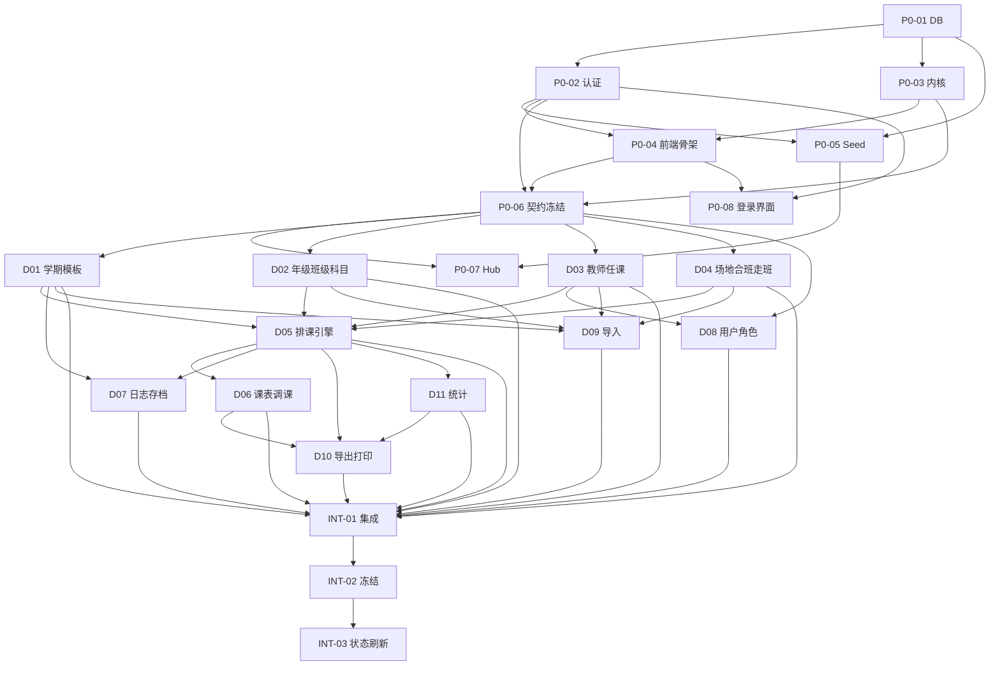

# 首轮规划总览（agent_plane.md）

| 项 | 值 |
|----|----|
| 项目 | 智能排课系统（paike） |
| 轮次 | v1 / 首轮开发（设计态） |
| 日期 | 2026-10-19 |
| 规划范围 | 22 张卡片：P0-01~P0-08、D01~D11、INT-01~INT-03 |
| 本轮产出 | 架构设计 + 卡片拆解 + 逐卡测试对比（全部「未执行」） |
| 唯一真相 | `input/v1.0/PRD/12-V1.0封版PRD.md` |

---

## 1. 规划目标与边界

### 1.1 目标

1. 把 PRD F1-F20 完整映射到 5 个限界上下文 + 2 个应用模块。
2. 把 DDD 的 12 个聚合、29 组命令/事件、47 条规则、2 个状态机落到可执行卡片。
3. 让每张卡片都能独立开工、独立验收，且依赖关系无环、无悬空。
4. 为每张卡片留下测试案例对比记录，明确「已定结果 vs 设计预期」，不虚报执行。

### 1.2 边界

- **只设计，不实现**：不创建业务代码、不运行迁移、不执行测试。
- **不改输入**：`input/` 与 `output/` 下文件保持原样。
- **不新增需求**：所有卡片能力均可回溯到 PRD；裁决仅用于补全与消歧。
- **设计态结论**：`test-results/*.md` 的执行状态一律「未执行」。

### 1.3 交付物

| 类别 | 文件 |
|------|------|
| 架构 | `docs/trace/runs/v1/spac.md` |
| 规划 | `docs/trace/runs/v1/agent_plane.md`、`issues.yaml` |
| 测试对比 | `docs/trace/runs/v1/test-results/{card-id}.md`（22 份） |
| 共享约定 | `README.md`、`conventions.md`、`roles.md`、`scenes.md` |
| 数据锚点 | `schema-shared.sql`、`seed-anchors.sql` |
| 内核 | `shared-kernel-manifest.yaml`、`docs/knowledge/shared-kernel-api.md` |
| 知识 | `docs/knowledge/config-contract.md`、`dependency-graph.yaml`、`module-template.md`、`phase-contracts/p0~p3-contracts.md` |

---

## 2. 输入分析结论

### 2.1 输入使用情况

| 输入 | 读取内容 | 结论 |
|------|----------|------|
| PRD | F1-F20、§4 权限、§5 方案状态、§7 验收、§8 D3-D21、附件 A D15 | 完整，作为唯一真相 |
| DDD | boundedContexts / aggregates / commands / events / rules / stateMachines / contextMap / services | 结构可用；部分实体缺失，由裁决补齐 |
| 原型 | 页面结构、字段、表格列、按钮、文案 | 仅界面参考；已剔除演示与需求面板 |
| 测试.md | 89 条用例、78 条可验证、11 条整体孤儿、6 条子断言孤儿 | 作为验收输入 |
| 测试结果.md | 78 条静态结论（R/G/C/部分/原型偏离）、18 项原型缺陷 | 作为对比基线 |
| 产品裁决结论.md | A-01~A-22 | 已采纳 |
| 人工裁决.md | H-01~H-05（均选 A） | 已采纳 |
| 孤儿测试用例.md | 11 整体孤儿 + 6 子断言孤儿 + 3 永久孤儿 | 已登记，不冒充覆盖 |

### 2.2 差距报告

| 编号 | 差距 | 影响 | 处置 | 落点 |
|------|------|------|------|------|
| GAP-01 | 原型缺 08 号「用户与角色」页面 | 无界面参考 | 按 PRD F20 + 权限矩阵设计；沿用全站表格 + 抽屉范式 | D08 |
| GAP-02 | DDD 无导入/导出/打印上下文 | 无领域模型 | 设为 `exchange` 应用模块，只经查询服务与共享内核 | D09 / D10 |
| GAP-03 | DDD 无统计上下文 | 无查询模型 | 设为 `statistics` 应用模块，读 `WorkloadQueryService` | D11 |
| GAP-04 | DDD 无 `weekParity`、走班组、冲突明细、未排清单、调课历史 | 无法表达 PRD 关键规则 | 作为模型补全 M-03~M-07、M-16、M-21 落入表结构 | D05 / D06 |
| GAP-05 | DDD Account 缺密码/会话/锁定字段 | 无法满足 F20 与 H-02 | P0-01 建 `sys_user`/`sys_session`/`sys_login_attempt`；D08 复用 | P0-01 / P0-02 / D08 |
| GAP-06 | DDD 规则 R-047 未选定并发策略 | 验收口径不定 | 采用 H-01 A：乐观版本 + 409 刷新；零部分写入 | P0-03 / D05 / D06 |
| GAP-07 | 原型存在模拟排课、演示登录、假数据 | 误导实现 | 全部剔除，服务端实现 | D05 / P0-08 |
| GAP-08 | 原型 18 项缺陷（角色导航、冲突提示、撤销等） | 直接照抄会带缺陷 | 以 PRD 与测试用例为准重新设计 | D05 / D06 / D08 |
| GAP-09 | 子技能 `architecture-design-generator`、`plane-issue-decomposer`、`bmad-review`、`bmad-deep-recon` 未安装 | 无法按 skill 原样调用 | 主流程直接执行等价步骤：架构生成、卡片拆解、双 Gate 对抗评审 | 全流程 |
| GAP-10 | 11 条整体孤儿 + 3 条永久孤儿 | 覆盖率不能声称 100% | 在卡片与对比文档中显式登记；永久孤儿不计入覆盖 | agent_plane / test-results |
| GAP-11 | DDD 聚合属性为字符串描述、命令字段不完整 | 需手工补全 DTO | 以 PRD 字段 + Zod schema 补全 | 各领域卡 |
| GAP-12 | PRD 附件 A 与通用算法 tie-break 存在耦合 | 引擎可能逐格不一致 | 固定种子与稳定排序；D15 作为唯一公共断言；禁止特例 | D05 |

### 2.3 测试语料统计

| 指标 | 数值 |
|------|------|
| 用例总数 | 89 |
| 可验证 | 78（72 V + 6 P） |
| 整体孤儿 | 11 |
| 子断言孤儿 | 6 |
| 永久孤儿 | 3（OR-BD-004、OR-AP-016、O-LG-001-PERM） |
| 状态 R / G / C | 47 / 28 / 3 |
| 执行状态 | 全部「未执行」 |

领域分布：

| 域 | 用例数 | 可验证 | 整体孤儿 | 主要卡片 |
|----|--------|--------|----------|----------|
| BD 基础数据 | 31 | 28 | 2（BD-004、BD-008） | D01-D04、D09 |
| AP 排课 | 17 | 14 | 2（AP-012、AP-016） | D05、D07 |
| AT 课表调课 | 11 | 11 | 0 | D06 |
| AS 统计 | 3 | 3 | 0 | D11 |
| EX 导出 | 3 | 1 | 2（EX-002、EX-003） | D10 |
| CE 冲突 | 4 | 4 | 0 | D05 |
| CM 跨模块 | 6 | 5 | 1（CM-006） | P0-04、D07、D09 |
| LG 日志存档 | 5 | 5 | 0 | D07 |
| AU 账号权限 | 9 | 5 | 4（AU-001/002/003/005） | P0-02、D08 |

> 孤儿用例与子断言在对应卡片中单独列出，标注「不计入覆盖」，不得用相邻断言冒充通过。

---

## 3. 卡片规划

### 3.1 卡片清单

| ID | 名称 | Phase | 优先级 | 估算 | 依赖 |
|----|------|-------|--------|------|------|
| P0-01 | 数据库、迁移与共享表 | 0 | P0 | 5 | — |
| P0-02 | 认证、会话与安全基线 | 0 | P0 | 8 | P0-01 |
| P0-03 | 共享内核（HTTP/错误/校验/事件/审计/时间） | 0 | P0 | 8 | P0-01 |
| P0-04 | 前端骨架、布局、路由守卫与共享组件 | 0 | P0 | 8 | P0-01、P0-02、P0-03 |
| P0-05 | Seed 锚点与受控词表 | 0 | P0 | 3 | P0-01、P0-02 |
| P0-06 | 契约冻结六件套 | 0 | P0 | 8 | P0-02、P0-03、P0-04 |
| P0-07 | Hub 自动装配与边界门禁 | 0 | P1 | 3 | P0-03、P0-04、P0-05、P0-06 |
| P0-08 | 登录、强制改密、错误页与会话失效 | 0 | P0 | 5 | P0-02、P0-04 |
| D01 | 学期、作息模板与校历 | 1 | P0 | 8 | P0-06 |
| D02 | 年级、班级、科目与课时规则 | 1 | P0 | 8 | P0-06 |
| D03 | 教师、任课与账号联动 | 1 | P0 | 8 | P0-06 |
| D04 | 场地、合班与走班 | 1 | P0 | 8 | P0-06 |
| D05 | 排课引擎、方案生命周期与冲突 | 2 | P0 | 13 | D01-D04 |
| D06 | 五视图、拖拽调课、撤销重做与空闲 | 2 | P0 | 13 | D05 |
| D07 | 操作日志、学期存档与切换 | 3 | P0 | 8 | D01、D05 |
| D08 | 用户、角色与账号开通 | 3 | P0 | 8 | P0-06、D03 |
| D09 | 批量导入 | 3 | P1 | 8 | D01-D04 |
| D10 | Excel 导出与模板打印 | 3 | P1 | 8 | D05、D06、D11 |
| D11 | 工作量统计 | 2 | P1 | 5 | D05 |
| INT-01 | 端到端集成收口 | 4 | P0 | 8 | D01-D11 |
| INT-02 | 契约冻结归档与发布基线 | 4 | P0 | 3 | INT-01 |
| INT-03 | 状态刷新与交付确认 | 4 | P0 | 2 | INT-02 |

### 3.2 执行波次

```
W0: P0-01
W1: P0-02  P0-03  P0-05
W2: P0-04  P0-06  P0-08
W3: P0-07
W4: D01  D02  D03  D04
W5: D05  D08
W6: D06  D07  D09  D11
W7: D10
W8: INT-01
W9: INT-02 → INT-03
```

关键路径：P0-01 → P0-02 → P0-06 → D01 → D05 → D06 → INT-01 → INT-02 → INT-03。

### 3.3 每卡描述结构

每张卡按十段式书写：

1. `## 目标`
2. `## 验收标准`
3. `## 相关背景`
4. `## 约束`
5. `## 当前阶段`
6. `## 任务`
7. `## 验证`（≥2 条可执行检查）
8. `## 在开始改动之前`
9. `## 完成改动之后`
10. `## 测试案例对比验证`（额外强制段）

测试对比段固定包含：涉及用例、已定结果、设计预期（静态推演）、一致性判定、覆盖/孤儿说明、执行状态「未执行」。

---

## 4. 测试案例 → 卡片矩阵

### 4.1 基础数据（BD）

| 用例 | 卡片 | 说明 |
|------|------|------|
| TC-BD-001/002/003/005 | D01 | 学期字段、状态、模板必选、存档只读 |
| TC-BD-006/007 | D01 | 模板版本不可变、学期钉扎 |
| TC-BD-009/010 | D02 | 年级 CRUD 与引用保护 |
| TC-BD-011/012 | D02 | 班级命名与序号校验 |
| TC-BD-013 | D09 | 导入部分成功（班级） |
| TC-BD-014/015 | D02 | 科目受控与同义词 |
| TC-BD-016/017/018 | D02（规则）/ D05（生效） | 课时规则、三开关、冲突提示 |
| TC-BD-019/020/021 | D03 | 工号、引用保护、退校 |
| TC-BD-022/023 | D03 + D08 | 一键开通唯一性、重复开通幂等 |
| TC-BD-024/026 | D03（配置）/ D05（生效） | 任课约束与均衡 |
| TC-BD-025 | D09 | 任课导入行级错误 |
| TC-BD-027/029 | D04 | 场地名称受控、类型二值 |
| TC-BD-028 | D04 + D05 | 容量硬约束 |
| TC-BD-030/031 | D04 + D05 | 合班字段校验、作为排课单元 |
| TC-BD-004 | — | 整体孤儿，无卡片；不计覆盖 |
| TC-BD-008 | — | 整体孤儿，无卡片；不计覆盖 |

### 4.2 排课（AP）

| 用例 | 卡片 | 说明 |
|------|------|------|
| TC-AP-001 | D05 | 生成方案、三类冲突为 0 |
| TC-AP-002 | D05 | 冲突数与耗时展示 |
| TC-AP-003/004 | D05 | 冲突方案可保存、未排清单可定位 |
| TC-AP-005 | D05 | 另存多草稿独立 |
| TC-AP-006 | D05 | 覆盖发布二次确认与唯一正式 |
| TC-AP-007 | D07 | 切换学期草稿守卫 |
| TC-AP-008/009/010 | D05（锁）/ D06（移动拒绝） | 锁定保留、拒绝移动、解锁 |
| TC-AP-011/013 | D05 + D06 | 单双周生成与展示、第 1 周单周 |
| TC-AP-014 | D05 | 走班场地与教师双分配 |
| TC-AP-015 | D05 + D11 | 跨年级任课与统计累计 |
| TC-AP-017 | D05 | D15 逐格基准 |
| TC-AP-012/016 | — | 整体孤儿；不计覆盖 |
| O-AP-001-PERF | D05 | 性能子断言；H-03 转可执行 |

### 4.3 课表与调课（AT）

| 用例 | 卡片 | 说明 |
|------|------|------|
| TC-AT-001 | D06 | 五视图一致 |
| TC-AT-002 | D06 | 学期切换无串扰 |
| TC-AT-003/004 | D06 + D08 | 教师数据范围、导航隐藏 |
| TC-AT-005/006 | D06 | 拖拽保存、冲突不落库 |
| TC-AT-007 | D06 | 撤销/重做顺序 |
| TC-AT-008 | D06 + D07 | 调课二次确认与日志 |
| TC-AT-009/010/011 | D06 | 教师/管理员空闲、互补 |
| O-AT-007-GROUP | D06 | 成组批量子断言 |

### 4.4 统计、导出、冲突

| 用例 | 卡片 | 说明 |
|------|------|------|
| TC-AS-001/002/003 | D11 | 四类互斥、加班占位、周/学期口径 |
| TC-EX-001 | D10 | 三维导出逐字段一致 |
| TC-EX-002/003 | — | 整体孤儿；D10 设计参考，不计覆盖 |
| TC-CE-001/002 | D05 | 三类冲突明细与建议 |
| TC-CE-003 | D05 | 合法结果零冲突 |
| TC-CE-004 | D05 | 只本次忽略 / 去配置 |

### 4.5 跨模块、日志、账号

| 用例 | 卡片 | 说明 |
|------|------|------|
| TC-CM-001 | P0-04 + INT-01 | 七类二次确认 |
| TC-CM-002 | D01-D04 | 引用保护 |
| TC-CM-003 | D07 | 删除不影响存档 |
| TC-CM-004/005 | D09 | 导入超限与部分成功 |
| TC-CM-006 | — | 整体孤儿；D05/D06 并发设计参考 |
| TC-LG-001/002 | D07 | 日志完整与筛选 |
| TC-LG-003/004 | D07 | 存档前置、只读 |
| TC-LG-005 | D06 + D07 | 多学期隔离 |
| O-LG-001-PERM | D07 | 永久留存子断言；永久孤儿，不计覆盖 |
| TC-AU-004 | D08 | 用户 CRUD 与角色 |
| TC-AU-006 | P0-02 + P0-05 | 唯一预置 Admin |
| TC-AU-007/008 | D08 | 越权拒绝、管理员通行 |
| TC-AU-009 | D08 | 开通账号权限边界 |
| TC-AU-001/002/003/005 | P0-02（参考） | 整体孤儿；不计覆盖 |
| O-BD-022-LOGIN / O-AU-006-LOGIN / O-AU-009-LOGIN | P0-02 / D08 | 登录子断言；H-02 转可执行 |

### 4.6 覆盖率口径

- 可验证 78 条全部有承载卡片。
- 11 条整体孤儿无承载卡片，单独登记。
- 6 条子断言中 5 条可随 H-02/H-03 转可执行，`O-LG-001-PERM` 为永久孤儿。
- 任何卡片不得声称「全部通过」；本轮统一「未执行」。

---

## 5. 校验清单

### 5.1 机械校验

| 编号 | 检查项 | 结果 |
|------|--------|------|
| V-01 | `spac.md` §1-§11 齐全 | 通过 |
| V-02 | §11 无遗留待定项 | 通过（规则 R-047 已由 H-01 定案） |
| V-03 | `issues.yaml` 22 张卡、ID 唯一 | 通过 |
| V-04 | 每卡十段式 + 测试对比段 | 通过 |
| V-05 | 每卡 `## 验收标准` 非空 | 通过 |
| V-06 | 每卡 `## 验证` ≥2 条可执行检查 | 通过 |
| V-07 | `blocked_by` 与依赖图一致、无环 | 通过 |
| V-08 | Phase 0 卡片覆盖数据库/认证/内核/骨架/seed/契约/Hub/登录 | 通过 |
| V-09 | 契约冻结卡存在（P0-06） | 通过 |
| V-10 | 集成/冻结/状态刷新卡存在（INT-01~03） | 通过 |
| V-11 | 每卡 `test-results/{card-id}.md` 存在 | 通过 |
| V-12 | 所有测试执行状态为「未执行」 | 通过 |
| V-13 | 47 条 DDD 规则均有执行点 | 通过 |
| V-14 | 2 个 DDD 状态机均有持久化与验收卡 | 通过 |
| V-15 | 五视图查询含 dimension/objectId/parity 与响应结构 | 通过 |
| V-16 | 登录/改密界面与 H-02 一致 | 通过 |
| V-17 | 前端文案全部中文、用户友好 | 通过 |
| V-18 | 输入文件未被修改 | 通过 |

### 5.2 Gate 1（架构评审）

| 视角 | 检查 | 结论 |
|------|------|------|
| 对抗 | 上下文边界是否被跨域直写破坏 | 未发现；存档/切换走应用服务 |
| 对抗 | 状态机是否存在非法迁移 | 未发现；非法迁移统一 409 |
| 边界 | 学期切换、存档、并发、空数据 | 均有守卫与提示 |
| 边界 | D15 与通用算法冲突 | 固定种子 + 逐格断言；禁止特例 |
| 验证缺口 | 每张卡是否有可执行验证 | 均已补 ≥2 条 |
| 验证缺口 | 是否虚报测试通过 | 全部标注「未执行」 |

### 5.3 Gate 2（卡片评审）

| 视角 | 检查 | 结论 |
|------|------|------|
| 对抗 | 卡片是否越界修改其他域 | 每卡「约束」显式禁止 |
| 对抗 | 依赖是否倒置 | BFS 校验无环 |
| 边界 | 空库、首启、无正式课表、存档后 | 均有对应验收项 |
| 边界 | 导入超限、重复键、并发 | 均有错误路径 |
| 验证缺口 | 验收标准是否可观察 | 均为行为/数据断言 |
| 验证缺口 | 孤儿用例是否被冒充 | 显式标注不计覆盖 |

---

## 6. 依赖图



---

## 7. 风险与应对

| 风险 | 等级 | 应对 | 责任卡 |
|------|------|------|--------|
| 排课引擎复杂度高、易延期 | 高 | 先 D15 后性能；引擎与方案生命周期同卡；有界回溯 | D05 |
| 五视图若各自实现会不一致 | 中 | 单一查询服务 + 同一响应结构 | D06 |
| 导入/导出口径漂移 | 中 | 列字典单一来源 + 契约冻结 | P0-06 / D09 / D10 |
| 存档跨域事务 | 中 | governance 编排，不直写他域表 | D07 |
| 权限遗漏 | 中 | 每请求读库 + INT-01 权限项 | P0-02 / D08 / INT-01 |
| 测试覆盖缺口被误读为通过 | 中 | 孤儿单列 + 全部「未执行」 | 全卡 |
| 子技能缺失导致流程偏差 | 低 | 等价执行并记录偏差 | 全流程 |

---

## 8. 偏差记录

| 偏差 | 原因 | 处理 |
|------|------|------|
| 未调用 `architecture-design-generator` | 子技能未安装 | 直接产出 `spac.md` §1-§11 |
| 未调用 `plane-issue-decomposer` | 子技能未安装 | 直接按十段式拆解 22 卡 |
| 未调用 `bmad-review` / `bmad-deep-recon` | 子技能未安装 | 以对抗 + 边界 + 验证缺口三视角人工评审并记录 |
| 新增 `exchange` / `statistics` 应用模块 | DDD 无对应上下文 | 明确标注为非限界上下文，禁止反向依赖 |
| 扩充 DDD 枚举与表字段 | PRD 需要周次、冲突明细、锁定、调课历史 | 记录为 M 系列补全，契约冻结时统一 |
| 全部测试未执行 | 用户明确要求本轮只设计 | 所有对比标注「设计预期（静态推演）」 |

---

## 9. 交付确认

- [x] 架构设计 `spac.md` §1-§11
- [x] 卡片规划 `issues.yaml`（22 卡）
- [x] 逐卡测试对比 `test-results/`（22 份）
- [x] 共享约定与锚点文件
- [x] 依赖图与 Phase 契约
- [x] 机械校验 V-01~V-18
- [x] Gate 1 / Gate 2 等价评审
- [x] 偏差与孤儿登记
- [ ] 代码实现（本轮不做）
- [ ] 测试执行（本轮不做）
